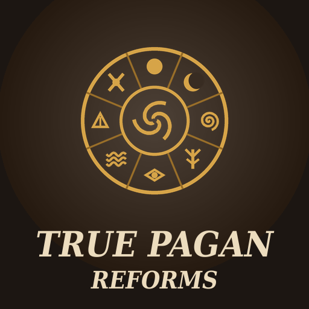

# True Pagan Reforms

A Crusader Kings III mod that makes AI pagan reformations less predictable. When an AI ruler reforms a pagan faith, some of the new faith's tenets are swapped for ones that fit the reformer, and some of its doctrines shift in the same direction: a lustful reformer may preach Carnal Exaltation and accept adultery, an eccentric mystic Esotericism and witchcraft, a sadistic warlord Human Sacrifice. Every playthrough gets its own reformed faiths.

- **Game version:** 1.20.x
- **Mod version:** 1.1.0
- **Author:** [Sourenics](https://github.com/Sourenics)

## Features

- **Only AI reformations.** When you reform a faith yourself, nothing changes: you keep the tenets and doctrines you picked.
- **1 or 2 tenets swapped**, depending on the game rule. A reformed faith has three tenets, so at least one always stays.
- **Kinship with the old faith.** If the reformed faith kept tenets from the unreformed one, at least one of them is always kept.
- **Shaped by the reformer.** The new tenets are drawn at random, weighted by the reformer's personality traits, lifestyle traits and education. A tenet that fits gets a much higher chance; one that does not fit can still appear, so results stay varied.
- **A tenet that already fits the reformer is more likely to stay**, and so is one inherited from the old faith.
- **No impossible faiths.** Every new tenet passes the game's own checks for the faith (`is_shown` and `can_pick`, including DLC requirements), and clashing combinations are avoided: no violent tenets in a pacifist faith, no Asceticism alongside Hedonism or Carnal Exaltation.
- **Special tenets are never removed.** Only common pagan tenets are swapped; tenets unique to a religion stay untouched.
- **Doctrines shift too.** Depending on its own game rule, 0 to 4 doctrines move one step to a neighbouring option (for example, Witchcraft from Shunned to Accepted or to Criminal, never straight from Criminal to Virtuous). Each doctrine changes at most once per reform, and the choice is weighted by the reformer's traits, gender and sexuality.
- **Doctrines that can change:** View on Gender, Religious Attitude, Clerical Tradition, Pilgrimage Attitude, Clerical Function, Clerical Gender, Clerical Marriage, Clerical Appointment, Marriage Type, Divorce, Bastardry, Consanguinity and all crime doctrines (Same-Sex Relations, Deviancy, Male and Female Adultery, Kinslaying, Witchcraft). The head of faith and special doctrines are never changed.
- **Doctrines and tenets stay compatible**, following the faith editor's rules: Adaptability only with Pluralist, Virtuous Deviancy only with Carnal Exaltation, no Theocratic tradition or spiritual appointment with a temporal head of faith, and no gender-dominated view under the full gender equality game rule.

### What fits whom

| Reformer | Favoured tenets |
|---|---|
| Lustful, Reveler | Carnal Exaltation, Hedonism, Ritual Celebrations |
| Chaste, Temperate, Humble | Asceticism |
| Gluttonous, Gregarious | Ritual Celebrations, Hedonism, Ritual Hospitality |
| Shy, Paranoid, Deceitful, Craven, Intrigue education | Sacred Lies, Esotericism, Chthonic Redoubts |
| Wrathful, Brave, Vengeful, Blademaster, Martial education | Warmongering, Gruesome Festivals, Unrelenting Faith |
| Sadistic, Callous | Human Sacrifice, Ritual Cannibalism, Exaltation of Pain, Gruesome Festivals |
| Zealous, Stubborn | Unrelenting Faith, Literalism, Sacrificial Ceremonies |
| Cynical, Arbitrary, Fickle | Adaptability, Pursuit of Power |
| Eccentric, Mystic, Learning education | Esotericism, Astrology, Auspicious Birthright |
| Ambitious, Greedy, Arrogant | Pursuit of Power, Auspicious Birthright |
| Content | Ancestor Worship, Communal Identity |
| Generous, Compassionate, Calm, Forgiving, Diplomacy education | Ritual Hospitality, Communal Possessions, Sacred Childbirth |
| Just | Legalism |
| Diligent, Patient, Stewardship education | Megalithic Constructions, Communal Possessions |
| Hunter, Herbalist | Sanctity of Nature |
| Physician | Sacred Childbirth |

Other tenets in the pool (Ancestor Worship, Adorcism, Sun Worship and the rest) can still be drawn with the base chance.

| Reformer | Favoured doctrines |
|---|---|
| Lustful, Reveler | Adultery Accepted, Deviancy Accepted or Virtuous, Concubines or Polygamous, Divorce Always Allowed, Clerical Marriage Allowed |
| Chaste, Temperate | Monogamous, Adultery and Deviancy Criminal, Clerical Marriage Disallowed, No Bastards |
| Zealous | Fundamentalist or Righteous, Theocratic, Mandatory or Encouraged Pilgrimage, Witchcraft Criminal |
| Cynical, Ambitious, Arrogant | Pluralist, Lay Clergy, Temporal Appointment, laxer Kinslaying |
| Eccentric, Mystic, Herbalist | Witchcraft Accepted or Virtuous |
| Paranoid | Witchcraft Criminal, Pilgrimage Forbidden, Temporal for Life appointment |
| Compassionate, Just, Forgiving | Kinslaying Criminal, Legitimization, Divorce Must be Approved |
| Sadistic, Callous, Arbitrary | Kinslaying Shunned or Accepted |
| Greedy, Stewardship education | Clerical Function: Control |
| Generous, Compassionate, Diplomacy education | Clerical Function: Alms and Pacification, Pluralist |
| Wrathful, Brave, Martial education | Clerical Function: Recruitment |
| Female reformer | Equal or Female Dominated, Clerical Gender Either or Female Only |
| Male reformer | Male Dominated, Clerical Gender Male Only |
| Homosexual or bisexual reformer | Same-Sex Relations Accepted |

### Game rules

Two rules in the game rules screen when starting a new game:

| Setting | **Pagan Reform Tenet Variation**: tenets swapped | **Pagan Reform Doctrine Variation**: doctrines changed |
|---|---|---|
| None | — | 0 |
| Light | 1 | 1 |
| Moderate (default) | 1 or 2, even odds | 2 |
| Strong | 2 | 3 or 4, even odds |

In a save started before the doctrine rule existed, doctrines use the Moderate setting.

### Languages

English and Spanish. Players using any other game language see the English text. Translations are welcome: open an [issue](../../issues/new/choose) or post them on the Steam Workshop page.

## Installation

### Steam Workshop

Subscribe on the Steam Workshop page and enable the mod in the Paradox launcher.

### Manual

1. Download this repository (green **Code** button → **Download ZIP**).
2. Copy the contents of the `mod/` folder (`true_pagan_reforms/` and `true_pagan_reforms.mod`) into:
   - **Windows:** `Documents/Paradox Interactive/Crusader Kings III/mod/`
   - **Linux:** `~/.local/share/Paradox Interactive/Crusader Kings III/mod/`
   - **macOS:** `~/Documents/Paradox Interactive/Crusader Kings III/mod/`
3. Enable **True Pagan Reforms** in the Paradox launcher.

## Compatibility

- No DLC required. Tenets that need a DLC are only used if you own it.
- Overrides no vanilla file. It hooks into `on_faith_created` by appending to it, so it works alongside other mods that use the same on_action.
- Can be added to an existing save; reformations that already happened are not changed. Can be removed at any time.
- Faiths changed by the mod stay as they are if you remove it.

### Testing it yourself

With the console open (`-debug_mode` launch option), type `effect tpr_debug_vary_my_faith = yes` to apply the variation (tenets and doctrines) to your own faith's main rite as if your character were an AI reformer. Use it on a test save: it changes your faith.

## Reporting bugs

Please open an [issue](../../issues/new/choose) using the **Bug report** template. To be able to fix the problem we need:

1. **The `error.log` file** from the session where the problem happened:
   - **Windows:** `Documents/Paradox Interactive/Crusader Kings III/logs/error.log`
   - **Linux:** `~/.local/share/Paradox Interactive/Crusader Kings III/logs/error.log`
   - **macOS:** `~/Documents/Paradox Interactive/Crusader Kings III/logs/error.log`

   The log is overwritten every time the game starts, so copy it right after the problem happens, before launching the game again. Ideally, reproduce the problem in a session with **only True Pagan Reforms enabled**.
2. **The game version** (shown in the main menu, for example 1.20.0.4) and **the mod version**.
3. **Your active DLCs** and **your full mod list in load order**.
4. **Which faith** was reformed, by whom, and which tenets and doctrines it ended up with.
5. **Screenshots** of the faith window, if possible.

## Credits

Idea and testing by Sourenics.

## License

**True Pagan Reforms** © 2026 Sourenics, licensed under [Creative Commons Attribution-ShareAlike 4.0 International (CC BY-SA 4.0)](https://creativecommons.org/licenses/by-sa/4.0/).

Forks, translations and alternative versions are welcome, provided that you:

- **Credit the original author** (Sourenics) and link to this repository.
- **Indicate the changes** you made.
- **Release your version under the same license** (CC BY-SA 4.0).

### Paradox Interactive content

Crusader Kings III and its content are © Paradox Interactive AB and are **not** covered by this license. This includes the tenets, traits and game concepts the mod refers to. This project is an unofficial fan-made mod, not affiliated with or endorsed by Paradox Interactive. Like every CK3 mod, it must be distributed free of charge.
